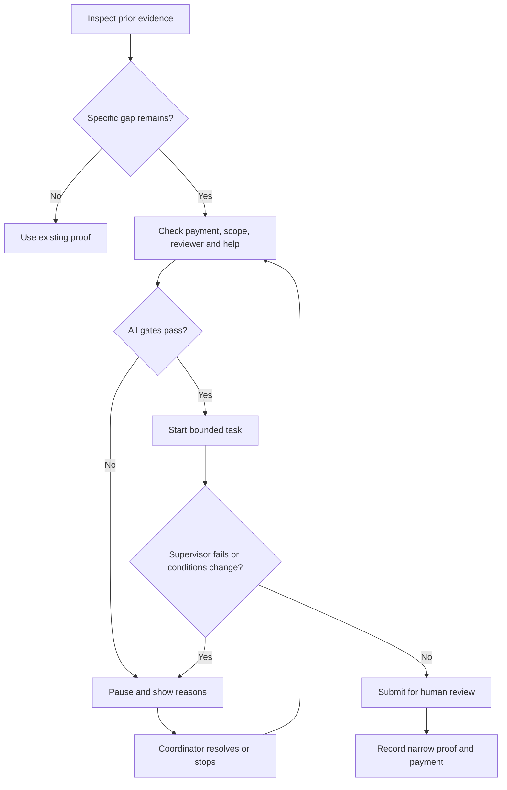
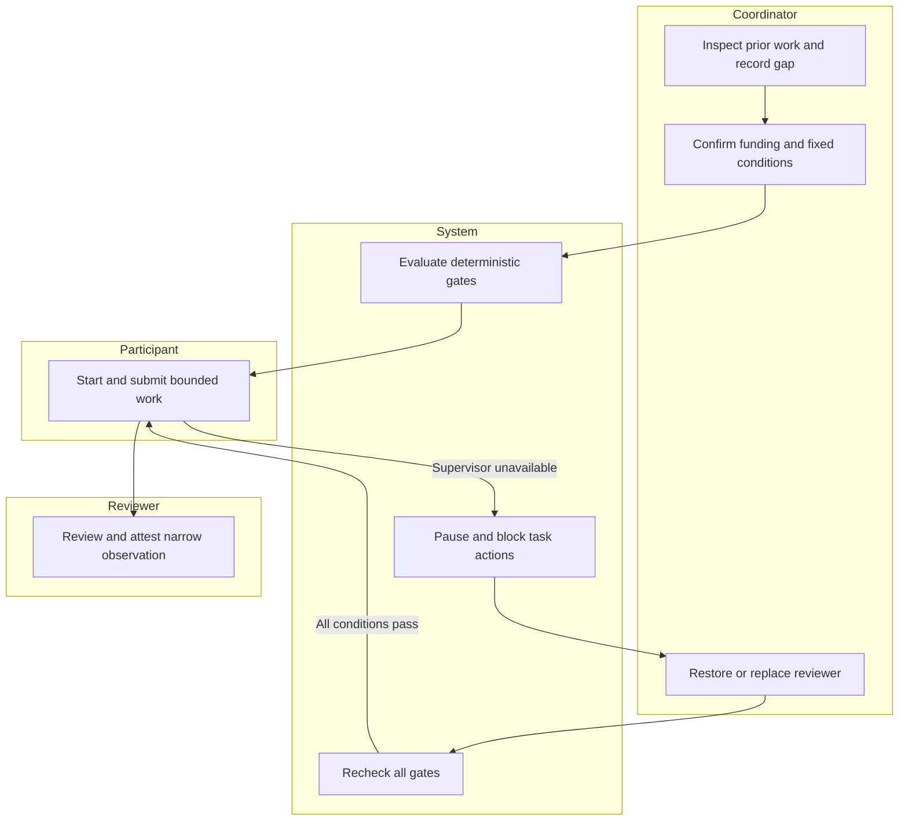

# First-Proof · Week 9 · Fernanda Espinosa

Packet created before application code, 12 October 2026 UTC / 11 October Mexico City.

## Problem and exact user
A first administrative experience fails when nobody owns supervision, review or payment. Exact user: a coordinator supporting 10 fictional early-career adults in Mexico City, two businesses and a named reviewer. This implements Fernanda's OPERATOR declaration in Team 4's Blueprint: deliberately fail supervision and pause until restored, replaced or stopped. First-Proof is the primary vacuum; micro-experience only fills a specific evidence gap after considering prior work.

## Success before the module closes
The coordinator can check existing evidence, identify the remaining gap and intended hiring decision, confirm payment/scope/supervision/review/help, start a bounded task, trigger supervisor failure, observe a blocked submission, replace or restore supervision, and resume only when every gate passes. Repeated work triggers separate human review. Stopping is always available. All data and AI output are labeled simulated.

## Image-generated mockup

Image generation was requested before implementation. The conceptual screen is not evidence of functioning software.

## Flowchart

## Actor swimlane

## Benchmark
The strongest relevant global benchmark selected for this slice is Parker Dewey, whose short paid professional projects offer employers a way to observe early-career work: https://www.parkerdewey.com/companies (checked 12 October 2026).
Mine localizes the coordinator's Spanish-language failure-and-recovery workflow in Mexico, with existing evidence first and an explicit guard against repeated disposable work. This is a design comparison, not a claim of market superiority. Forage offers free self-paced simulations, a useful practice benchmark kept separate from paid work: https://www.theforage.com/about.

## Three-year view
If the slice works, First-Proof becomes a coordinated bridge from existing work to narrow evidence inspected by an actual employer. Paid assignments fill only meaningful gaps and cannot become a permanent substitute for junior roles. Expansion follows reliable funding, reviewer capacity and consequential hiring actions, not participant counts.

## Scope cut
No CV builder, job board, employability score, hiring guarantee, real payments, real employers, actual verification service, personal-data storage or production LLM integration. Browser memory resets on reload. Human roles are simulated controls, not authenticated authority. VERIFIED describes a fictional human walkthrough and never an AI judgment; no real credential is issued.

## Architecture and stack
| Layer | Implementation | Limit |
|---|---|---|
| LLM | LLM-assisted development plus labeled deterministic AI-draft simulation | No runtime model call; simulated mode allowed by assignment |
| Structured data | Fictional task, gates, proof status, supervisor availability, timestamps | Operator attestations in demo; not externally verified |
| One more | Deterministic state machine and automatic pause logic | Human resolves reasons |
| UI | Buildless HTML/CSS/JavaScript | Memory only |
| Hosting | Sites static deployment, private default | Not Vercel or Supabase |

## Blueprint mapping
1. Preserve DECLARED/VOUCHED/VERIFIED; AI cannot upgrade; show source, conditions, AI assistance, corrections, dependencies, missing information and inference limits.
2. Inspect prior work and require a named evidence gap first.
3. Start/resume requires funding, fixed scope, available supervisor, capacity, criteria and escalation. Any failure pauses.
4. Show intended employer decision and record simulated open/review/action; no real hiring outcome asserted.
5. Participant pays zero; business funding gate is an illustrative operator confirmation, not a processed transfer.
6. Repeat/cadence/hours/process flags require human review and stop micro-experience when continuing work is suspected. Threshold is conservative demo policy, not research finding.

## Security floor
No secrets or external API keys. No personal data storage or database; Supabase auth and RLS are inapplicable to this fictional, memory-only prototype. Only fixed fictional records; no free-text inputs. Select inputs checked against enumerations; user-controlled strings never inserted as HTML. Production personal records would require Google sign-in and per-user RLS before use. No claim of a security rating.

## Test plan
Use Node assertions for start gates, failure pause, blocked submission, replacement without funding, terminal stop, repeated-task review and narrow proof status. Mechanical pass must record an actual observed bug, regression and fix, followed by second deploy. Synthetic persona: fictional coordinator Elena, 32, Spanish-speaking, time-pressed, comfortable with spreadsheets, anxious about payment and unsure whether replacing a supervisor restarts work; inspect real screens when supported. Do not claim a fresh-chat screenshot persona pass unless actually performed.

## Acceptance and commit plan
1 Packet and implementation prompt before code.
2 Structured state engine and gates.
3 Coordinator interface and simulated evidence.
4 Initial deploy.
5 Mechanical tests, observed bug and correction.
6 Persona/accessibility correction, session close and second deploy.
