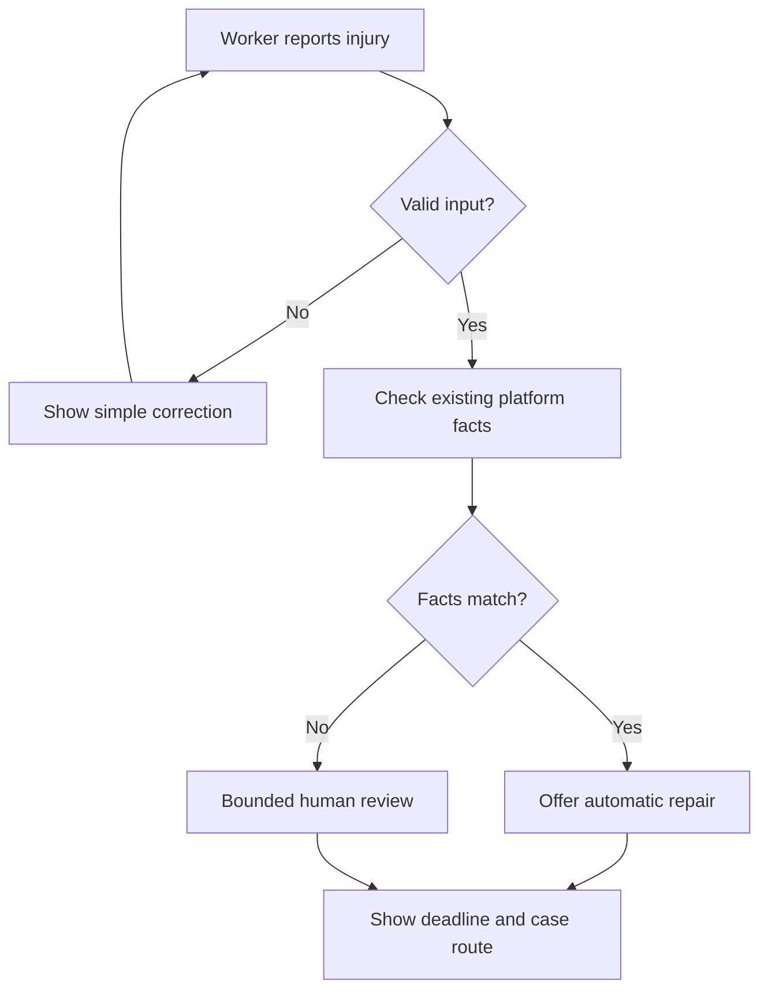
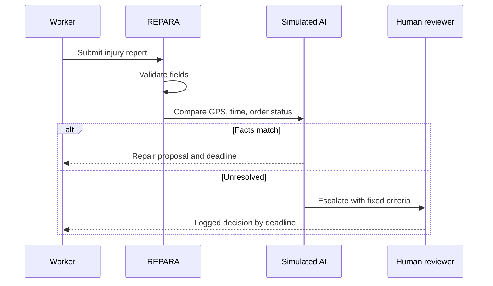

# REPARA - Build Packet

## Problem in my words

Delivery workers can suffer a verified injury during an order and still receive no clear remedy from the platform or insurer. Explanation alone is not enough; a negative or silent response must open a practical repair path.

## Exact user

A Mexico City delivery worker who was injured during an active order, uses a phone, and should not need legal or technical knowledge to request repair.

## Success definition

Before the module closes, a worker can submit a fictional injury report, validate the required information, receive a simulated verification from structured platform data, see a fixed repair deadline, and request bounded human review.

## Mockup

The generated mobile mockup shows one clear action, a case timeline, a fixed deadline, and a permanent notice that the case cannot affect rating or tenure. The production interface follows this hierarchy.

## Feature flow

## Swimlane

## Benchmark line

The best existing solution for work-injury remedy is Singapore's Work Injury Compensation Act process. REPARA localizes its no-dead-end logic for Mexican platform workers through mobile-first Spanish, existing platform facts, and a permanently separated repair record.

## Long view

In three years, REPARA could become a neutral harm-response layer used across multiple delivery platforms in Mexico. It could coordinate verified incidents, time-bound insurer responses, evidence correction, and auditable escalation without determining employment status. Its load-bearing rule would remain unchanged: repair evidence can never become a score of worker worth.

## Scope cut

- No credit score or worker score.
- No real medical, identity, or location data.
- No payment processing or legal employment determination.
- No new surveillance and no live platform API in this classroom slice.
- No open-ended human discretion.

## Architecture and stack

| Layer | Choice | Purpose |
|---|---|---|
| Interface | React + Vinext | Mobile-first guided flow |
| Structured data | Typed fictional platform record | GPS, timestamp, and active-order facts |
| LLM/AI layer | Deterministic simulated evaluator | Clearly labeled classroom demonstration |
| State | In-memory browser state | Avoid storing personal data |
| Hosting | ChatGPT Sites | Free live production URL |

## Security floor

- No secrets or API keys.
- No personal data is stored; all examples are fictional and labeled.
- Every field has type, format, and length validation.
- AI output is explicitly labeled simulated.
- Verification and remedy never affect rating, tenure, credit, or worth.

## Test plan

1. Open the live URL on desktop and mobile.
2. Submit an empty form and confirm clear validation messages.
3. Enter an invalid order number and confirm it is rejected.
4. Complete fictional order MX-48291 and confirm the verified route appears.
5. Enter another valid-format order and confirm bounded review appears.
6. Confirm the fixed deadline and shadow-clause notice remain visible.
7. Confirm no form data remains after starting over or refreshing.
